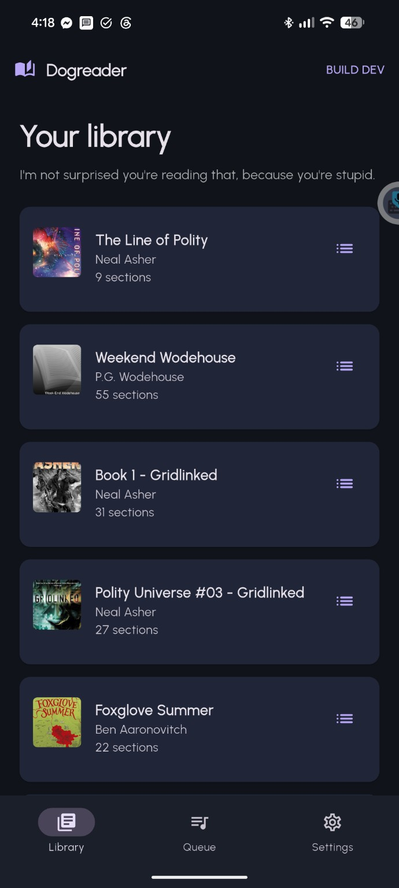
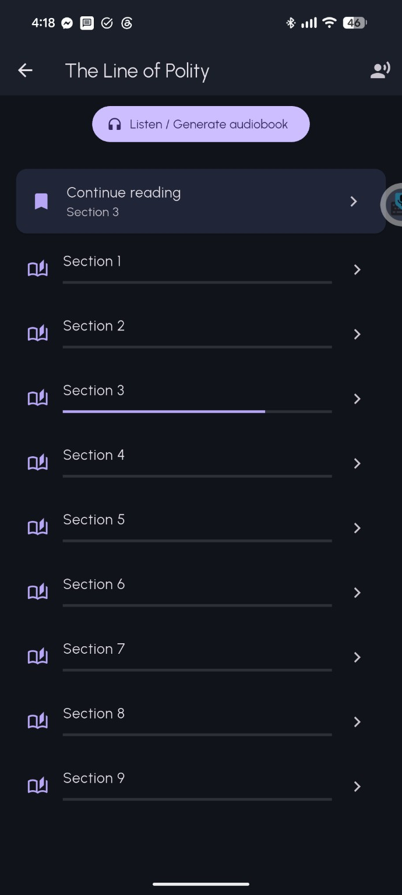
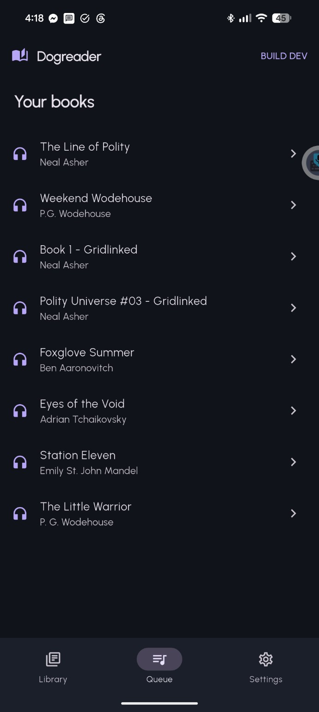
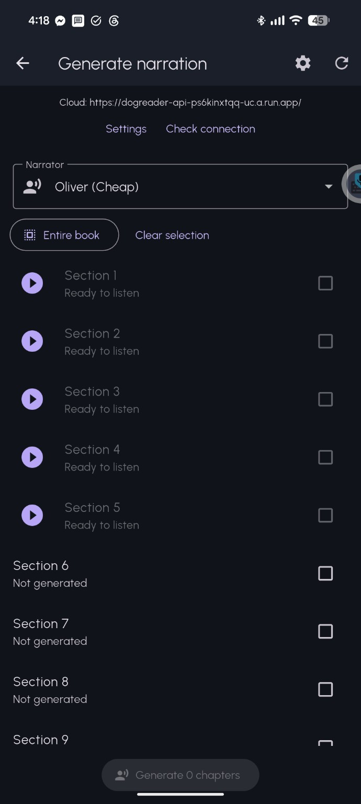

# Dogreader

**An Android EPUB reader and audiobook player with on-demand AI narration.**

Dogreader is a personal software project built with Flutter. It combines paginated ebook reading, downloadable chapter narration, and persistent reading/listening progress in one Android app. A Google Cloud backend generates narrated audio asynchronously so the phone does not need to synthesize entire books.

> **Project status:** Active development. The latest verified Android build is **118**. This is not yet a polished public release; some features, including Android notification/lock-screen media controls, are still being debugged.

## Screenshots

Actual screenshots from the Android app (work in progress).

| Library | Reading and chapters |
|:--:|:--:|
|  |  |
| Narration | Chapter queue |
|  |  |

## What it does

- **Read EPUBs:** Import local EPUB files, browse a book library, and read with paginated text and saved position.
- **Listen offline:** Generate chapter narration, download MP3s to the device, and play them without a network connection.
- **Manage narration:** Queue selected chapters or an entire book for cloud generation and check job status.
- **Keep your place:** Store reading progress and narration position across sessions.
- **Continue listening:** Advance to the next chapter when the corresponding downloaded audio is available.
- **Control playback:** In-app play/pause, seeking, and playback speed. Android system media controls are implemented but currently under investigation.

## Architecture

```text
Android app (Flutter)
  |-- EPUB import, pagination, library and local state
  |-- just_audio + audio_service for narration playback
  |-- locally downloaded chapter MP3s
  |
  +-- HTTPS narration requests --> Google Cloud Run API
                                  |
                                  +--> Cloud Tasks queue
                                          |
                                          +--> narration worker
                                                |-- Google Cloud Text-to-Speech
                                                +-- Google Cloud Storage (MP3)
                                  |
  <------------- job status and audio download
```

The backend separates long-running text-to-speech work from the phone. The app submits jobs, polls for completion, and downloads finished audio. The cloud pipeline uses idempotent job identifiers and worker safeguards to reduce duplicate processing.

The backend is a separate component; this repository primarily contains the Flutter Android application.

## Technology

- **Client:** Flutter / Dart
- **EPUB handling:** `epubx`, `html`
- **Audio:** `just_audio`, `audio_service`
- **Backend:** Python API on Google Cloud Run, Cloud Tasks, Cloud Storage, Google Cloud Text-to-Speech
- **Builds:** GitHub Actions for Android APK validation and signing

## Builds and versioning

Android APKs are built and verified using **GitHub Actions**, not distributed from ad-hoc local builds. Build **118** was produced by [this successful workflow run](https://github.com/timpac/dogreader/actions/runs/40240592089) from commit `dda43c6d46a6ede20a8a60d6703b0472bbd066ce`.

The release process is being hardened to require every new candidate to descend from the latest approved release, verify its version and signing identity, and preserve a known-good rollback artifact. A successful CI build is not automatically an approved release.

**Do not assume the repository's default branch is the newest verified build.** Consult the approved release record and exact workflow commit before preparing an update.

## Development

The application is an Android-targeted Flutter project. For local source inspection and analysis:

```bash
flutter pub get
flutter analyze
```

Production-style update APKs should be created through the repository's verified GitHub Actions workflow so signing and version checks are applied consistently.

The cloud narration service requires separate deployment and configuration. Never commit cloud credentials, signing keystores, API tokens, or local `.env` files.

## Current priorities

- Repair Android notification and lock-screen media controls.
- Improve playback reliability and protect continuous listening behavior.
- Expand narrator selection and voice previews.
- Add article import and a listening queue.
- Strengthen automated regression tests and the release promotion process.

## Project philosophy

Dogreader is designed first as a useful personal reading and listening tool: a quiet reading interface, with more advanced narration controls available when needed. The project is under active iteration; bugs and incomplete features are documented rather than hidden.

## Feedback

Technical feedback on the Flutter architecture, Android audio lifecycle, asynchronous narration workflow, and release engineering is welcome.

**License:** No open-source license has been granted. Please ask before redistributing or reusing the code.
